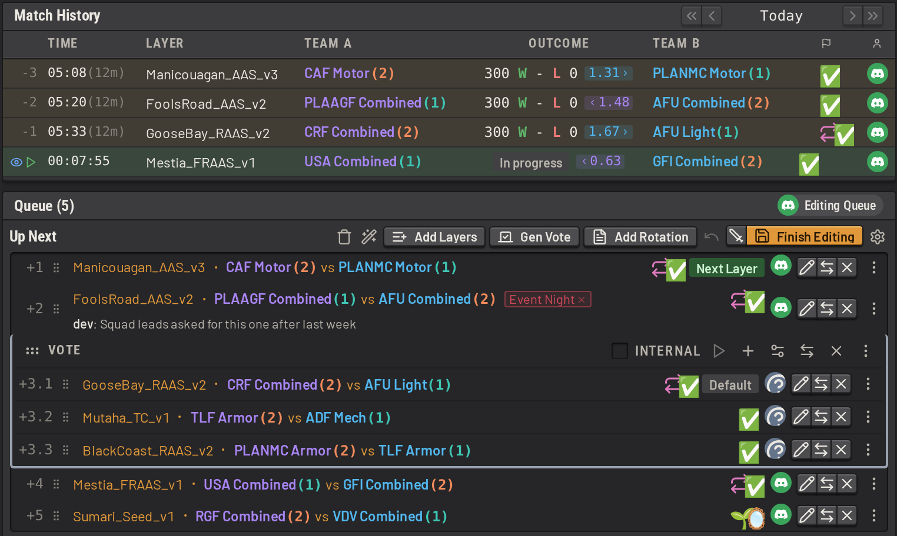

# Squad Layer Manager (SLM)

SLM is a tool for managing upcoming layers on a Squad server, and other things also.

**Documentation: https://tactrigsds.github.io/squad-layer-manager/**

**Discord: https://discord.gg/Th7g2nhpR/**

SLM is the main admin tool of the TacTrig server. Admins use it to queue layers, check team balance, run teamswaps,
and warn, kick or time out players, from a web GUI or with in-game commands.




Read the [documentation](https://tactrigsds.github.io/squad-layer-manager/) to learn more.

## Try it

Spin up a demo instance with no authentication:

```sh
docker run --rm -p 127.0.0.1:3000:3000 -e DEMO=1 ghcr.io/tactrigsds/squad-layer-manager:latest
```

## Documentation

Read these pages on the [documentation site](https://tactrigsds.github.io/squad-layer-manager/), which adds search,
or as markdown here:

- [Layer selection](docs/features/layer_selection.md): the queue, filters, repeat rules, votes and layer requests
- [Player management](docs/features/player_management.md): teams, admin actions, swaps, and the activity feed and history
- [Integrations and hosting](docs/features/integrations_and_hosting.md): in-game commands, Discord, BattleMetrics,
  permissions, plugins and self-hosting
- [Installing](docs/installing.md): get SLM running
- [Configuring](docs/guide/configuring/overview.md): configure SLM for your squad server
- [Learning SLM](docs/features/learning_slm.md): the in-app tutorials and the sandbox server
- [FAQ](docs/faq.md): short answers to common questions, with links to the full docs
- [Upgrading and downgrading](docs/guide/operations/upgrading.md): release channels, migrations and rolling back
- [Backups and restoring](docs/guide/operations/backups.md): what gets backed up, uploading it offsite, and putting one back
- [Server agent](docs/guide/operations/server_agent.md): stream a game host's logs and proxy its RCON to SLM
- [Layer data](docs/guide/operations/layer_data.md): the layer artifact pair, how it is resolved, and building your own
- [Writing a plugin](docs/developers/writing_plugins.md): the plugin contract, and packing one for admins to install
- [Plugin UI](docs/developers/plugin_ui.md): where a plugin can render in the app, and the components it can use
- [Contributing](CONTRIBUTING.md): local dev setup, the test suites, and the pre-push hook

## Support SLM

SLM is free and open source. Donations fund its development: [ko-fi.com/grey275](https://ko-fi.com/grey275).
