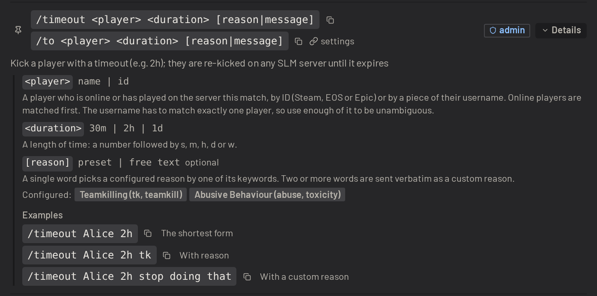
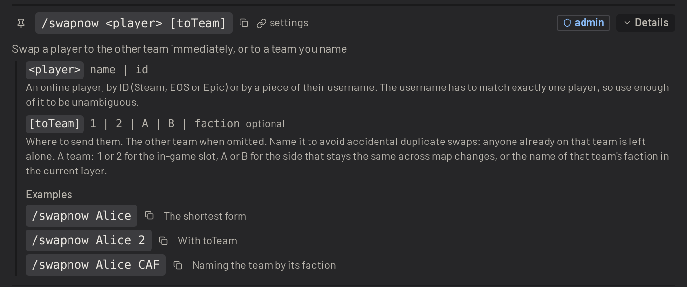
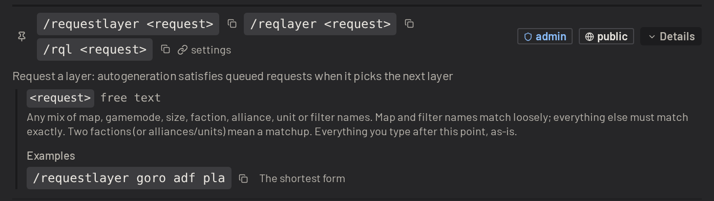
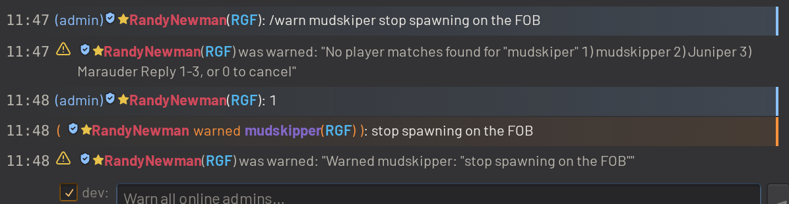

# In-game commands

From the game's chat, admins can start votes, swap, warn, kick and time out players, broadcast to the server, flag
players, add notes and request layers. Players can use the public commands, such as `/switch` to ask to switch teams,
`/admin` to call for an admin, and `/requestlayer` to request a layer. Each command runs with the permissions of the player who types it. See
[Permissions and access control](permissions.md).

Type `/help` in game to list the commands. Commands are case-insensitive, and player, squad and flag names match on any part
of the name.

## The commands page

The _Commands_ page lists every command an install has, with a searchable quick reference of pinned commands at the
top.

A command's details list each of its arguments, the reasons configured for it, and examples to copy.

## Triggers and shortcuts

A command runs when one of its _triggers_ is typed in chat. `/timeout` and `/to` are both triggers for the timeout
command. Any command can take more triggers, including shortcuts with arguments filled in, such as `/to2h` for a two-hour timeout.
See [Command triggers](../guide/configuring/command_triggers.md).

Commands start with `/` by default. An install can change the prefix, or give a command a trigger with another prefix,
such as `!switch` beside `/switch`. See [Command prefixes](../guide/configuring/admin_actions.md#command-prefixes).

## Typo correction

When a word in a command matches nothing, or matches more than one thing, SLM asks which one was meant instead of
failing. SLM warns the player with up to 3 of the closest matches. Typing 1 to 3 picks one, and 0 cancels.

Typo correction covers player names, squads, teams, flags, action reasons, `/help` sections and the words of a layer
request. When a command has more than one word to correct, SLM asks about each in turn, or takes one number per
question at once, such as `1 2`. A choice expires after 45 seconds, or when the player types another command.
