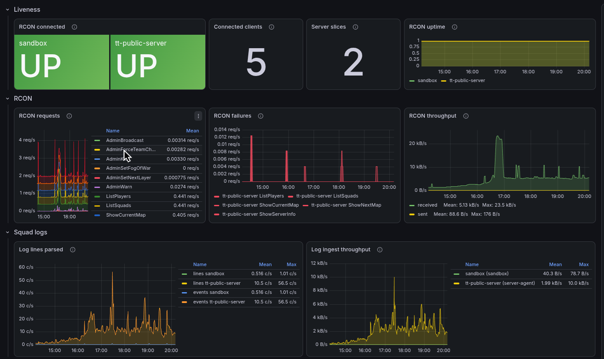

# Integrations and hosting

SLM connects to Discord, BattleMetrics and Steam, can be extended with plugins, and runs from one Docker image on your
own machine.

## Integrations

### Discord

Users sign in with their Discord account. Roles can be assigned to a Discord role, a Discord user or every member of
your Discord server. Your server's emoji can mark layers in the queue. When a link to a selection of events from the
[activity feed or history page](server_monitoring.md#server-activity) is posted in Discord, SLM replies with the events
attached as a text file.

### BattleMetrics

SLM reads your organization's player flags and notes from BattleMetrics, and sets flags and posts notes from the
dashboard or in game. A grouping mode can sort players into groups by flag, for balance. See
[BattleMetrics flags and notes](player_management.md#battlemetrics-flags-and-notes).

### Steam and Squad Browser

SLM looks up the link that joins your server, through the Squad Browser API or through Steam, and the dashboard shows
a button that opens your server in Squad.

## Plugins

Plugins add commands, settings, behaviour and UI to SLM. A plugin installs from the URL its author provides, and is
configured and started on the settings page. See [Plugins](../guide/configuring/plugins.md). SLM ships with three:

| Plugin           | What it does                                                              |
| ---------------- | ------------------------------------------------------------------------- |
| AFK Kicker       | Kicks AFK players when people are waiting in the queue, longest AFK first |
| Balance Triggers | Watches recent match outcomes and warns admins when they look one-sided   |
| Teamkill Warns   | Warns players when they have been teamkilled                              |

To write a plugin, see [Writing a plugin](../developers/writing_plugins.md).

## Self-hosting

SLM ships as one Docker image, with its database stored in a file beside it. An install script sets up the compose
file and config, and SLM migrates its own database on upgrade. See [installing.md](../installing.md).

The compose file also includes an optional observability stack: Grafana, an OpenTelemetry collector and VictoriaMetrics.
Its preconfigured dashboards chart SLM's metrics, logs and traces, such as RCON traffic and failures, log ingestion and
the connection state of each server. See [installing.md](../installing.md#9-telemetry).

- **Many servers.** One install manages any number of Squad servers. Connect each one through its log file on disk,
  over SFTP for hosted servers, or through the [server agent](../guide/operations/server_agent.md), which keeps your RCON password on the
  game host.
- **Sandbox server.** A fresh install starts with an emulated Squad server, for learning SLM and testing settings
  without touching real players. See [sandbox_servers.md](../guide/operations/sandbox_servers.md).
- **Backups.** SLM backs up its database before every upgrade, and on a schedule if one is set, and can upload the
  backups over SFTP. See [backups.md](../guide/operations/backups.md).
- **Server console.** Read the RCON traffic and log lines exactly as SLM receives them, to find whether a problem is
  in the connection or in SLM. See [server_console.md](../guide/operations/server_console.md).
- **Mods.** SLM's layer catalog covers vanilla Squad, SuperMod, Resurgence and Galactic Contention. See
  [Mod support](layer_selection.md#mod-support).
