# Layer selection

SLM manages the layer rotation of one or more Squad servers. Admins work from a web app that signs in with Discord, and
from in-game commands. To install SLM, see [installing.md](../installing.md). To learn SLM by using it, see
[Learning SLM](learning_slm.md).

## The layer queue

The queue holds upcoming layers for the server, as a list of _queue items_. A queue item is either a single layer, or a
[vote](#votes) between several layers. When a queue item reaches the top, SLM sets the queue item's layer as the
server's next layer. For a vote, that layer is the vote's default choice until the vote ends, and the winning choice
after. When the queue runs out, SLM generates a layer from your layer pool, the set of layers your server may play, and
marks the generated layer with a dice icon. [Filters and the layer pool](#filters-and-the-layer-pool) describes the pool
below.

Several admins can edit the queue at once, and each one sees who else is editing. Layers can be added one at a time, as
a generated vote, or as a whole rotation, pasted in or picked from the [saved rotations](#saved-rotations). Queue items
can carry colour-coded tags and freeform notes.

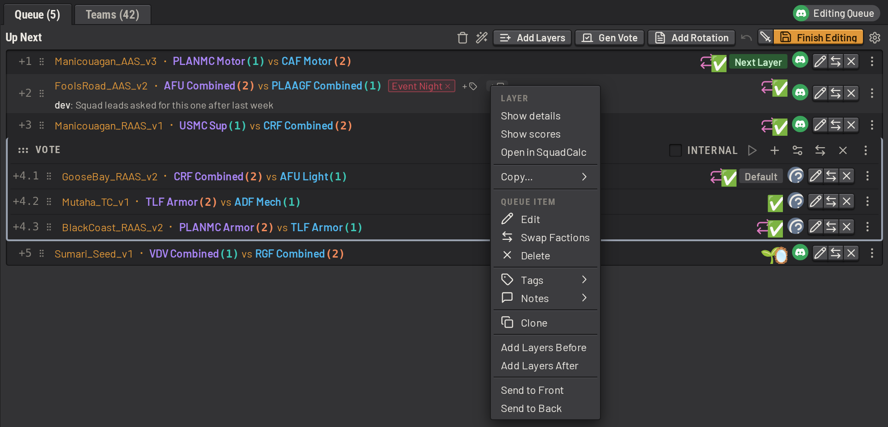

## The layer selection dialog

Use the layer selection dialog to search the full layer catalog for layers to add to the queue. Filters narrow the
catalog, along with constraints on map, gamemode, factions, units and vehicles. The results can be shuffled, weighted
toward preferable layers. Each layer is marked when it falls outside your pool or would break a
[repeat rule](#repeat-rules). The selected layers go into the queue as separate queue items or as one vote.

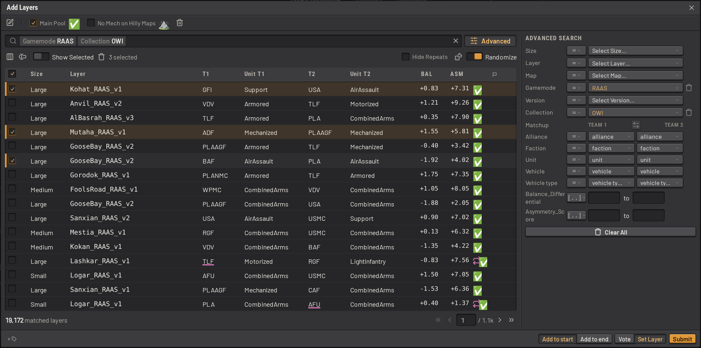

SLM works on a phone. The dialog lists layers as cards there, with the filters and the selected layers on tabs of their
own. SLM can also be installed as an app, which opens in its own window. See
[Can SLM be installed as an app?](../faq.md#can-slm-be-installed-as-an-app).

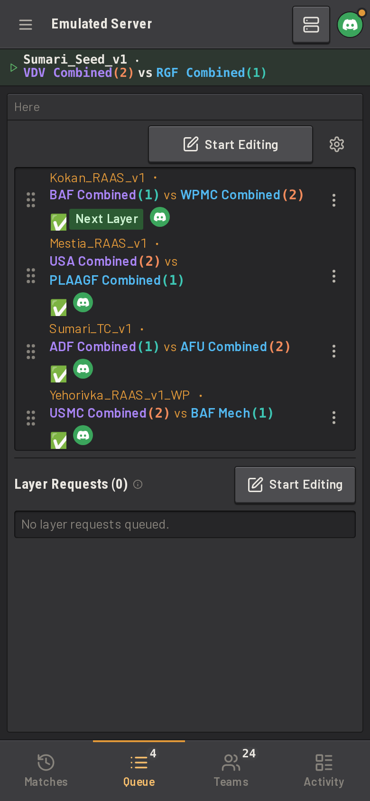
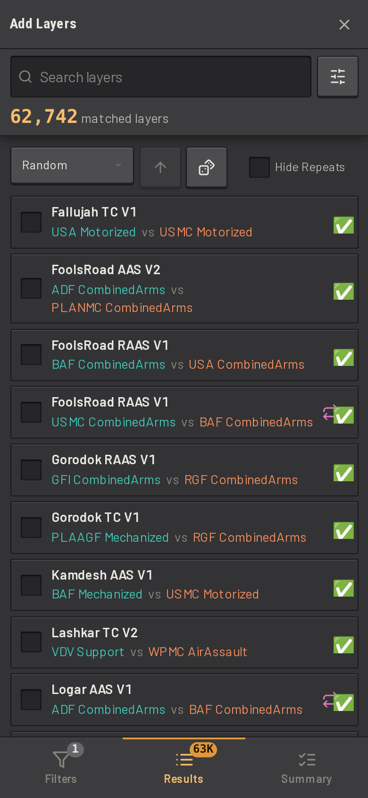

## Filters and the layer pool

The base game offers about 730,000 layers, counting every map, gamemode, faction and unit combination, and mods add
more. A _filter_ is a named expression that picks a subset of them out, such as "no mechanized units on hilly maps". A
filter can reference other filters. Filters can be edited in a visual builder or as YAML text.

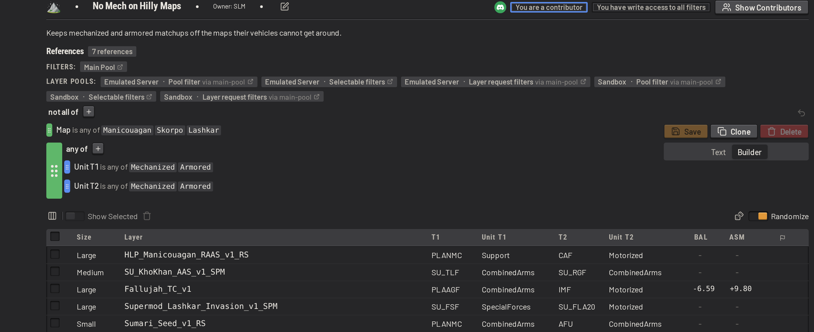

Filters decide which layers admins can select by default and which layers SLM generates when the queue is empty. A
filter can also mark the layers it matches with an emoji, as a category. See
[Layer pool and filters](../guide/configuring/layer_pool.md).

Use the _Filters_ page to search filters by name or description, narrow the list to one author, and sort it. A search
lists the matches as rows and shows what matched. Each filter card's menu, also opened by right-clicking the card,
provides _Clone_, which copies the filter under a new name, and _Delete_. A filter that something still references
cannot be deleted.

## Repeat rules

A _repeat rule_ defines how soon a map, layer, faction or unit may be played again, counting both the queue and the
recent match history. The defaults catch the same map within 4 matches, the same layer within 7, and the same faction
on the same side within 3. A rule can be narrowed to named values, such as Skorpo alone over 10 matches.


SLM marks each layer that breaks a repeat rule with , and underlines the
repeated value in pink on both the marked layer and the earlier layer it repeats.

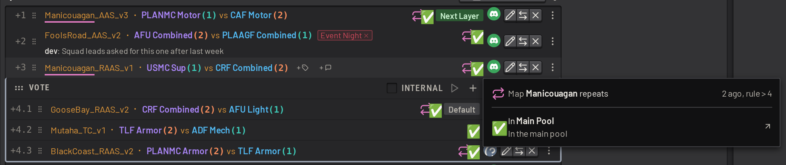

Use _Fix Repeats_ to clear repeat warnings automatically. SLM reorders the queue and swaps layers' teams to clear as
many warnings as possible, with as few changes as possible. See [Fixing repeats](../guide/configuring/layer_rotation.md#fixing-repeats).

## Saved rotations

A _rotation_ is a saved, ordered list of queue items: single layers and votes, with their tags and notes. Rotations are
kept on the _Rotations_ page, so a rotation can be added to any server's queue in one go. A note in a rotation names no
author.

Use the _Rotations_ page to search rotations by name, description or layer, to filter them by rotation tag or author,
and to sort them by name or by when they were created or modified. Each rotation card provides _Clone_, which copies the
rotation under a new name, and _Archive_ and _Delete_ in its menu. An archived rotation is listed only while _Show
archived_ is ticked. Rotation tags group rotations on the page, and are defined on the settings page under _Rotation
tags_.

A rotation's layers are edited the same way as the queue's. Press _Start Editing_, change the layers, and press
_Save_. Several admins can edit a rotation at once, and each one sees the others' changes as they are made. Each
rotation uses a [repeat ruleset](../guide/configuring/layer_rotation.md#repeat-rules), and the editor marks every layer
that breaks one of its repeat rules.

Use _Export_ in the rotation editor to copy a rotation's layers out as YAML or plain text, and _Import_ to read layers
in from either format. The file holds the layers alone, without the rotation's name, description, tags or repeat ruleset.
Both formats write a layer as the line SLM sends with `AdminSetNextLayer`, so a layer line copied from one format pastes
into the other.

```yaml
# Opening layer. Keep it light while the server fills.
- Gorodok_RAAS_v1 USA+Motorized RGF+Armored
- layer: Narva_AAS_v2 BAF+CombinedArms VDV+AirAssault
  tags: [Event Night]
- vote:
     - GooseBay_RAAS_v2 CRF+CombinedArms AFU+LightInfantry
     - Mutaha_TC_v1 TLF+Armored ADF+Mechanized
  display: [map, factions]
  duration: 3m
```

In YAML, each `#` line directly above a layer or a vote choice is a note on it. Tags are written by label. A vote's
first choice is its default. `display` sets what the vote shows players, from `map`, `gamemode`, `layer`, `factions`
and `units`, and `duration` sets how long the vote runs. A vote without them uses the server's vote settings.

Plain text holds one layer per line, with `#` lines as notes on the next layer. A vote starts with a `# VOTE:` line,
which takes the same `display` and `duration` settings, separated by `;`. The vote's choices follow it, indented, and
the vote ends at the next line that is not indented. Plain text leaves tags out.

```text
# Opening layer. Keep it light while the server fills.
Gorodok_RAAS_v1 USA+Motorized RGF+Armored
Narva_AAS_v2 BAF+CombinedArms VDV+AirAssault
# VOTE: display map, factions; duration 3m
  GooseBay_RAAS_v2 CRF+CombinedArms AFU+LightInfantry
  Mutaha_TC_v1 TLF+Armored ADF+Mechanized
```

SLM detects the format of an import, names every line it cannot read, and blocks the import until each one is fixed.
A tag label that matches no tag can be created, dropped, or mapped onto an existing tag. The imported layers can
replace the rotation's layers, go ahead of them, or follow them. Import is available once _Start Editing_ is pressed.

Creating a rotation needs `rotations:create`. Whoever created a rotation can edit it, along with the users and roles
added to it as contributors. `rotations:write-all` allows editing every rotation.

To add a rotation to the queue:

1. Press _Start Editing_ on the queue.
2. Press _Add Rotation_.
3. On the _Paste_ tab, paste layers one per line or a rotation exported as YAML or plain text. Or pick a rotation on
   the _Saved Rotation_ tab.
4. Pick _Replace_ to replace every layer in the queue, or _Add to start_ or _Add to end_.
5. Press the add button, then save the queue.

Every item added from a saved rotation carries a tag showing the rotation's name. Each of the rotation's notes shows a
rotation icon in place of an author, and only an admin with `queue:manage-all-notes` can change one.

## Layer details and scores

Each layer shows a balance score and an asymmetry score, and compares its two teams on anti-infantry, armor, logistics
and transportation. The scores are heuristics for how fair a matchup is likely to be. They come from a system
created by community member ZERO, and refined through feedback on the TacTrig server. A custom layer dataset can
replace the scores. See [Building custom layer data](../developers/custom_layer_data.md). The current scores predate recent game changes. A
revised scoring system is in progress.

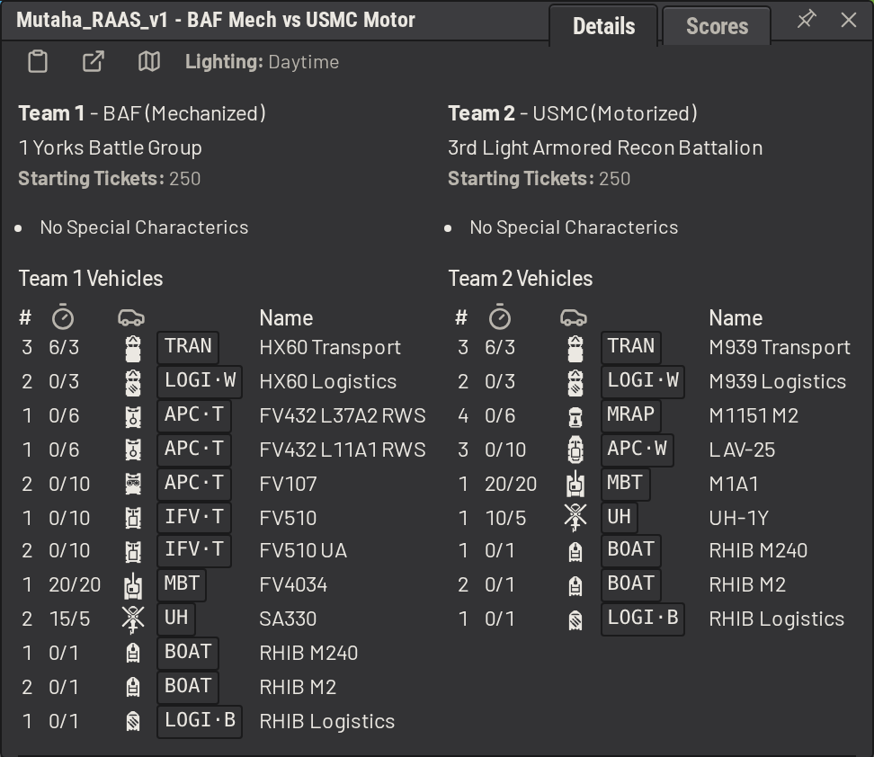
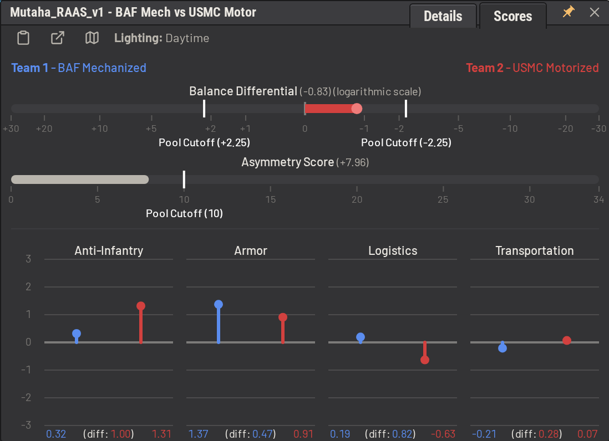

## Votes

A vote lets players choose the next layer from several choices. Use the _Generate Vote_ dialog to generate each choice
from the pool, under optional constraints such as a different map for every choice. A choice can be edited or regenerated on
its own.

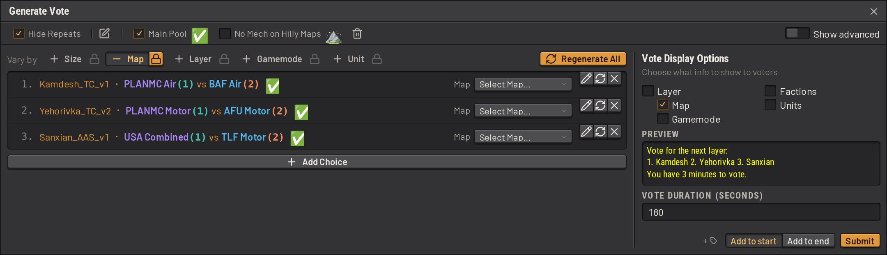

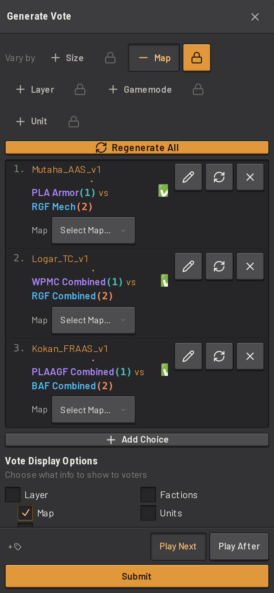

A vote starts from the dashboard, in game with `/startvote`, or by itself partway into a match. Players vote by typing
a choice's number in chat, and SLM broadcasts the choices and reminders to the server. An internal vote polls only the
admins.

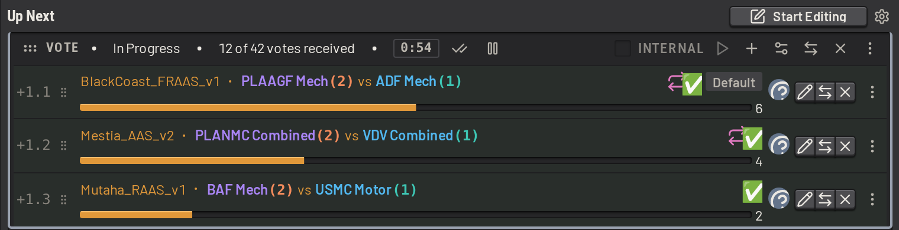

Each vote sets its own duration, and which parts of a layer the choices spell out, such as the map, gamemode or
factions.

## Squad's in-game voting

SLM also works on a server that uses Squad's own in-game voting system. When an in-game vote starts, or SLM infers that
voting was turned on with `AdminEnableVoting 1`, SLM stops setting the next layer, so SLM and the vote never fight over
it. The server's dashboard shows that an in-game vote is deciding the next layer.


## Layer requests

A layer request asks for a layer with specific characteristics, without editing the queue by hand. A request names any
mix of map, gamemode, faction, unit or filter. `/reqlayer fallu raas usa rgf` requests Fallujah RAAS with USA against
RGF. When the queue runs out of deliberately queued layers, SLM generates the next layer from the requests, and
satisfies as many of them as it can at once. If one admin requests WPMC and another requests Narva, the generated layer
can be WPMC on Narva.

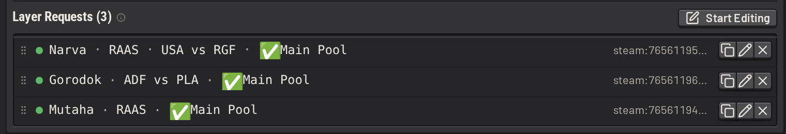

## Mod support

SLM's layer catalog covers vanilla Squad and three mods: SuperMod, Resurgence and Galactic Contention. Each layer's
_Collection_ column records whether the layer is vanilla (`OWI`) or which mod it comes from, so a filter can include or
exclude a whole mod. Each server's settings name the mods that server has installed, and SLM never queues, generates or
offers a layer from a mod the server lacks.

A custom layer dataset can replace the built-in one, with other mods, other scoring or extra columns. See
[Layer data](../guide/operations/layer_data.md) and [Building custom layer data](../developers/custom_layer_data.md).

A layer the catalog does not know can still be queued as raw text, in the format `AdminSetNextLayer` takes, such as
`Narva_RAAS_v1 RGF USMC`. Open raw input from the
 icon in the _Add Layers_ dialog.

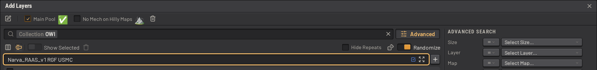
