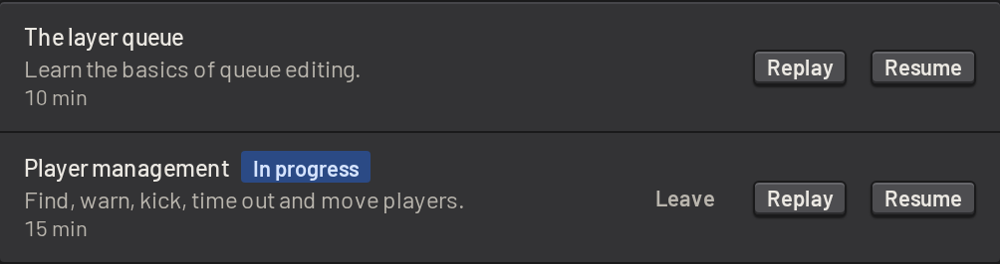
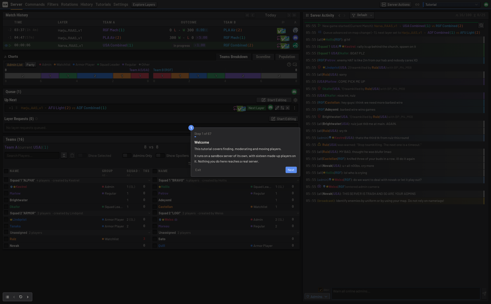
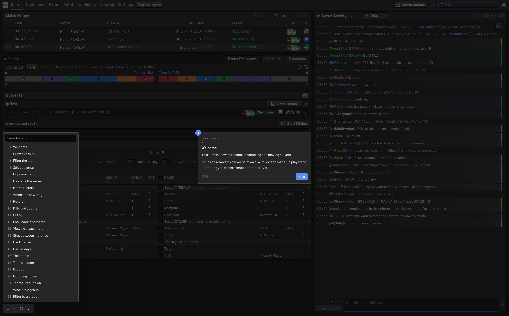

# Learning SLM

SLM is learned inside the app, by using it. Guided tutorials teach the server dashboard, and a sandbox server gives
admins somewhere to practise.

## Tutorials

The tutorials walk through the server dashboard step by step. They open from _Tutorials_ in the nav bar, and SLM
offers them the first time a user opens a server's dashboard.

| Tutorial          | Length | Covers                                                                              |
| ----------------- | ------ | ----------------------------------------------------------------------------------- |
| The layer queue   | 10 min | reading and editing the queue, picking layers, filters and repeat rules, generation |
| Player management | 15 min | the activity log, match history, teams and groups, warns, kicks, timeouts and swaps |



Each tutorial runs on a sandbox server of its own, with sixteen made-up players who chat, fight and teamkill. Nothing
done in a tutorial reaches a real server. Each step highlights one part of the dashboard and explains it. Some steps
ask for an action, such as warning a player or adding a layer, and wait until it is done.



A tutorial's contents can be searched to jump straight to a topic.



Leaving the dashboard pauses a tutorial. Resume it, or replay a finished one, from the _Tutorials_ page. The tutorials
need a desktop, with a mouse and keyboard.

## Practising on the sandbox server

A fresh install starts with a server named _Sandbox_, attached to an emulated Squad server. Admins can try the queue,
votes and player actions there without affecting real players. See
[Sandbox servers](../guide/operations/sandbox_servers.md).

## Tooltips and the commands page

Tooltips can be found throughout the app. Hover over a button, icon or label you do not recognise to see more about
it. The _Commands_ page lists every in-game command and how to use it. See [In-game commands](ingame_commands.md).

## Trying SLM without installing it

Run a demo instance with no authentication:

```sh
docker run --rm -p 127.0.0.1:3000:3000 -e DEMO=1 ghcr.io/tactrigsds/squad-layer-manager:latest
```

Open http://localhost:3000 and sign in with any username. The demo starts with example data and needs no Discord
server. Everything in it is discarded when the container stops.

Anyone who can open the demo signs in as an admin, and the demo encrypts its settings with a key published in the SLM
repository. Enter no real credential into it, and do not publish its port to a network you do not control. The command
above accepts connections from this machine only.
