# Player management

SLM helps admins moderate and balance the players on their servers, from the dashboard or in game.

## Teams and balance

The teams panel lists both teams by squad, side by side, or in one table when the panel is too narrow. A _grouping
mode_ sorts players into coloured groups by [BattleMetrics](integrations_and_hosting.md#battlemetrics) flag, Discord
role, a pattern on their name, or their group in a standard Squad admin list. A player's username takes their group's
colour wherever it is shown. Two grouping modes cover the common needs: one for balance and one for admin purposes.

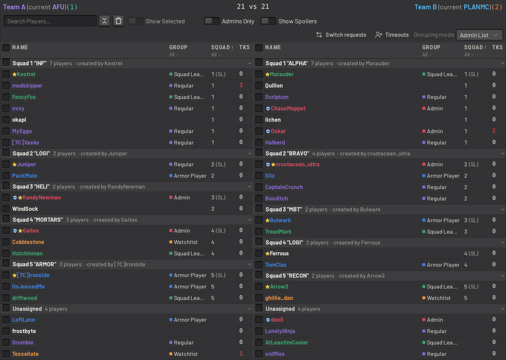

The built-in _Party_ grouping mode groups players by the in-game party they queued with, so admins can filter, sort and
select a team by party.

The _Teams Breakdown_ chart counts each team's players by group. See [Charts](server_monitoring.md#charts).

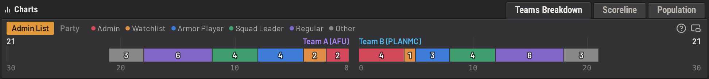

## Player details

A player's details window lists their IDs and profile links, their groups and BattleMetrics flags, their team and
squad, and their recent chat.

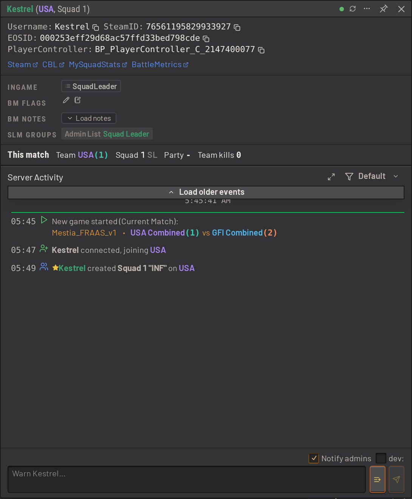

A history icon beside the username marks a player who has gone by other usernames. Click it to list each username and
the dates the player used it.

Use the expand button beside the activity filter to give the player's server activity the whole window. Press it again
to bring back the rest of the player's details.

## Admin actions

Admins can warn, kick, time out, kill or swap a player from the player's context menu, wherever the player's name or
row appears. From the same menu, admins can also remove a player from their squad, demote a commander, and manage the
player's BattleMetrics flags and notes. Disband a squad from the squad's own menu. Every player action also applies to a whole squad or to any selection of players at once.

A timeout kicks the player, and kicks them again whenever they rejoin any server SLM manages, until the timeout
expires or is cancelled. `/timeout Kestrel 2h spamming in command chat` times Kestrel out for two hours.

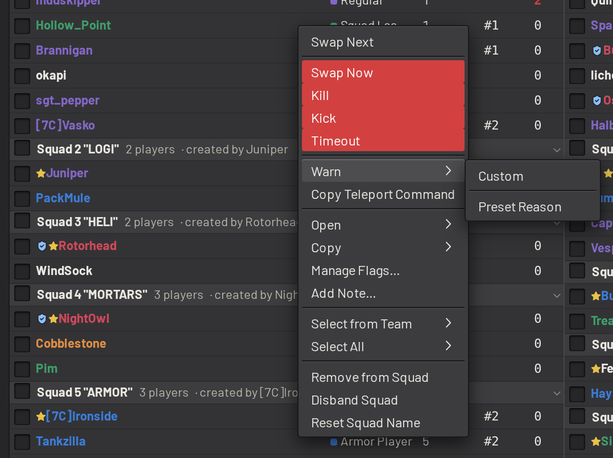

On a phone, the same actions open from a menu button at the end of each player's row.

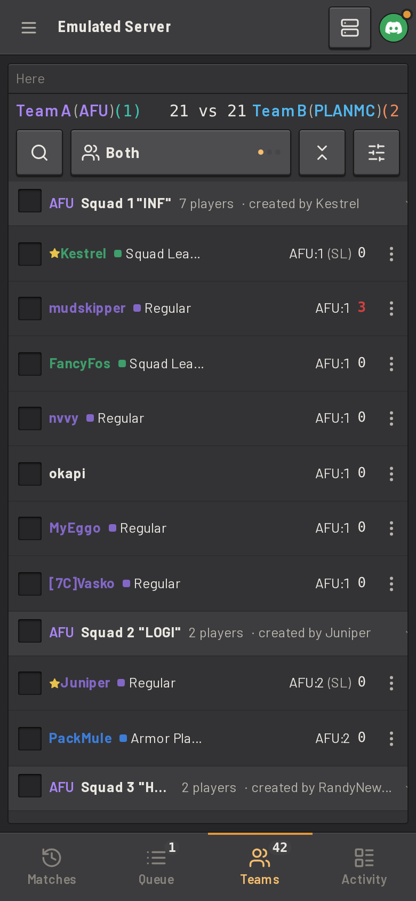
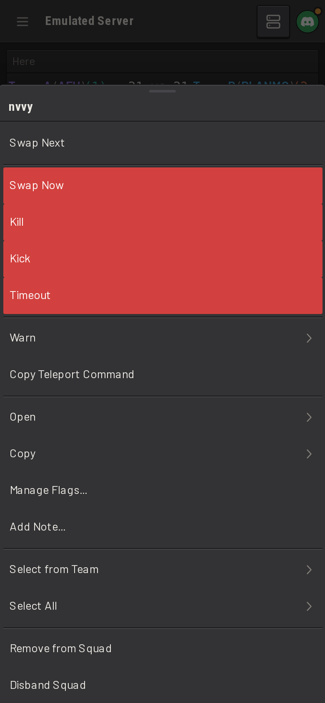

Roles decide which of these actions each admin may take, and can cap some of them, such as the longest timeout. See
[Permissions and access control](permissions.md).

### Message shorthands

A message shorthand is a preset message for a common offence, such as teamkilling or wasting assets. Each shorthand
holds one message per action, so a warn for teamkilling can read "Do not team kill." while a kick for the same
offence reads "You have been kicked for team killing." The dashboard's action dialogs offer the shorthands in a list,
beside a custom message. In game, a shorthand's keyword takes the place of the message: `/kick Kestrel tk` kicks
Kestrel with the _Teamkilling_ shorthand's kick message.

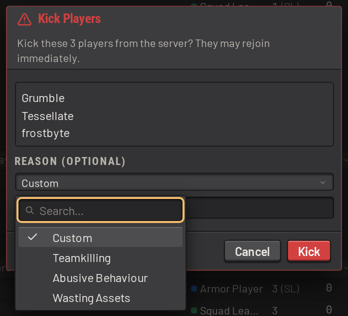

An install can require a reason for chosen actions. See
[Admin actions and commands](../guide/configuring/admin_actions.md#warns-broadcasts-and-admin-actions).

## BattleMetrics flags and notes

A [BattleMetrics](integrations_and_hosting.md#battlemetrics) flag marks a player in your organization, and a note is
free text on their BattleMetrics profile. Admins use notes to brief each other: why a player was warned, or what to
watch for next match. SLM sets flags and posts notes from the dashboard or in game, with `/flag` and `/note`, and signs
each note with the name of the admin who wrote it. A player's notes load in their details window, newest first.

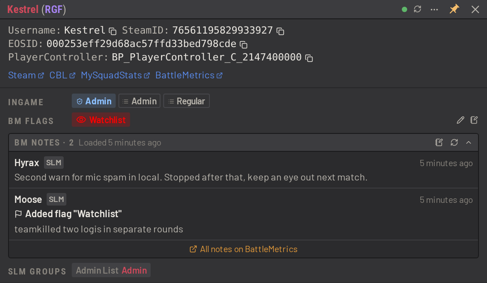

By default, SLM makes these changes with your organization's BattleMetrics token. An admin can save a personal access
token, so that their flag and note changes are made as their own BattleMetrics account. See
[Personal BattleMetrics tokens](../guide/configuring/players.md#personal-battlemetrics-tokens).

## Team swaps

Admins move players, selections and whole squads between teams, either on the next map roll or at once.

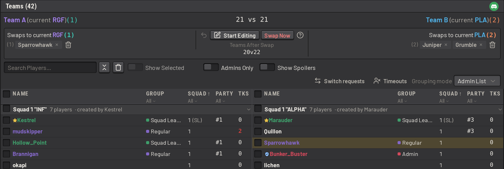

- Use _Swap Next_ to add the players to the swaps panel. The panel lists each pending swap under the team the player is
  moving to, and counts how the teams will stand after the swaps. Several admins can edit the swaps at once, as with
  the layer queue. On the next map roll, SLM moves everyone on the list, and retries a swap that does not land.
- Use _Swap Now_ to move the players at once, after a confirmation.

SLM warns each player in game when they are marked for a swap, when their swap is removed, and when an admin swaps
them on the spot. A swap keeps its destination across the map roll, even though the teams change sides. A player who
leaves, or reaches their destination on their own, is dropped from the list. In-game commands such as `/swapnext` and
`/swapnow` do the same from chat.

### Counterbalance

Turn on _Counterbalance_ to keep the teams the same size while admins edit the swaps. Whenever an admin queues or removes a swap,
SLM picks swaps from the other team so that the teams end up as even as possible. A party is always swapped together.
Counterbalance swaps carry a scale icon and a dashed outline. When players joining, leaving or switching teams unbalance
the saved swaps, SLM re-picks them after a countdown.

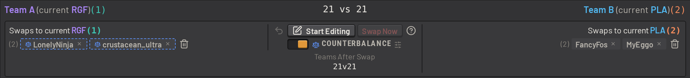

Each server chooses who SLM may pick, such as never picking players in a group or players with a high K/D in the
current match. See [Teamswap counterbalance](../guide/configuring/players.md#teamswap-counterbalance).

## Switch requests

Players ask to switch teams themselves with `/switch`, or a [trigger](ingame_commands.md#triggers-and-shortcuts) of
your own, such as `!switch`. Unlike an admin swap, a switch request waits for room on the other team, and lasts only
for the current match.

- If the player's team has more players than the other, SLM switches them at once.
- Otherwise they wait in line, first come first served on each side, and SLM reports each player's place.
- The first players in the two lines trade places.
- When a new player joins the team someone is waiting for, SLM moves the new player across and switches the waiting
  player into their slot.

A player leaves the line with `/cancelswitch`, and the line clears at every map roll. The _Switch requests_ window
shows both lines, with each player's place and the next pair to trade, and lets admins switch any player in it
straight away.

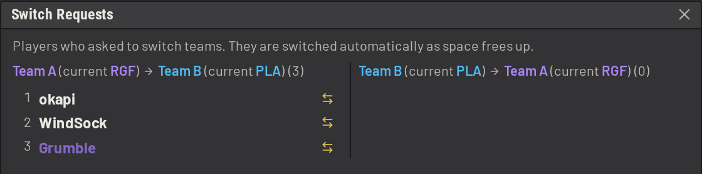
