# Monitoring and history

SLM records what happens on your servers. Follow the live match in the activity feed, chart the teams, the score and
the player count, and search every past event, player and match.

## Server activity

The activity feed records events from the Squad server and from SLM as they happen: chat, kills, joins and leaves,
admin actions, queue edits and more. SLM collapses repeats of noisy events into one line, and the feed can be filtered
by event type.

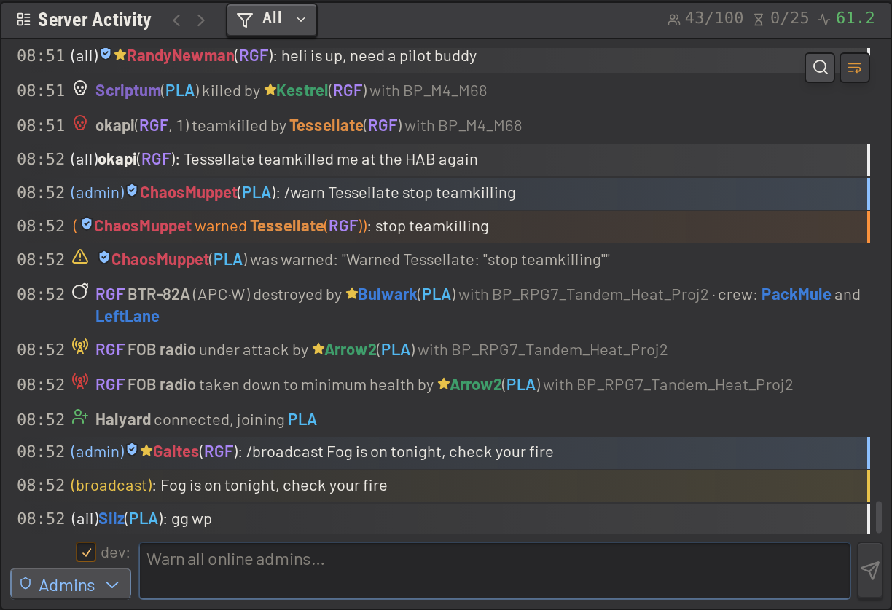

A range of events can be selected and copied as text, or shared as a link that opens on those events.

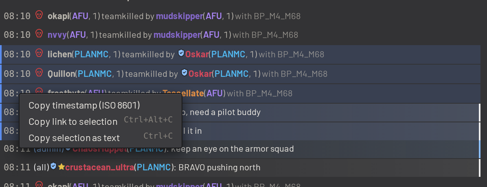

### Messaging admins and players

Use the chat box at the bottom of the activity feed to message the server without joining the game. A message can warn
every online admin, broadcast to the whole server, or warn the players selected in the teams panel, and can carry the
sender's name.

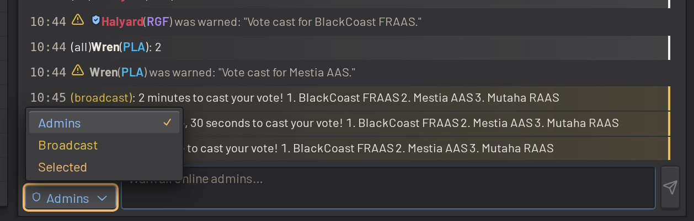

## Match history

The match history lists each match's layer, length, outcome and who set it. While a match is in progress, its row
displays each team's tickets as they change, once spoilers are shown (see _Spoilers_ below). Open a match to read its
log and how the teams were made up, or drag the match into the queue to play its layer again.

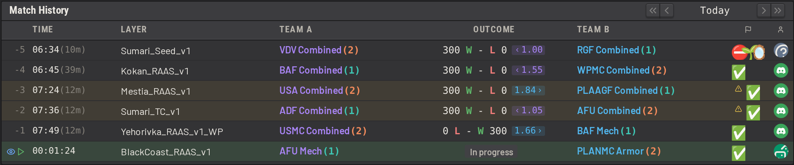

The activity feed and the match history each fill a tab of their own on a phone.

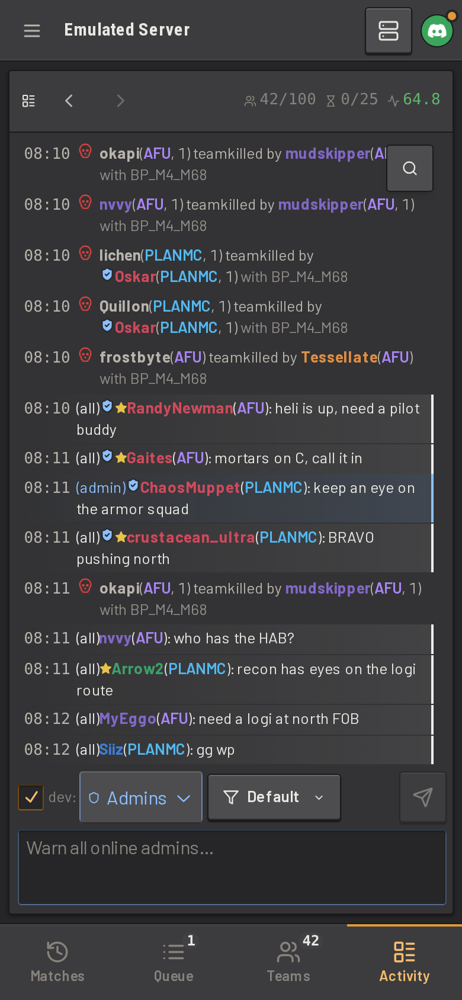
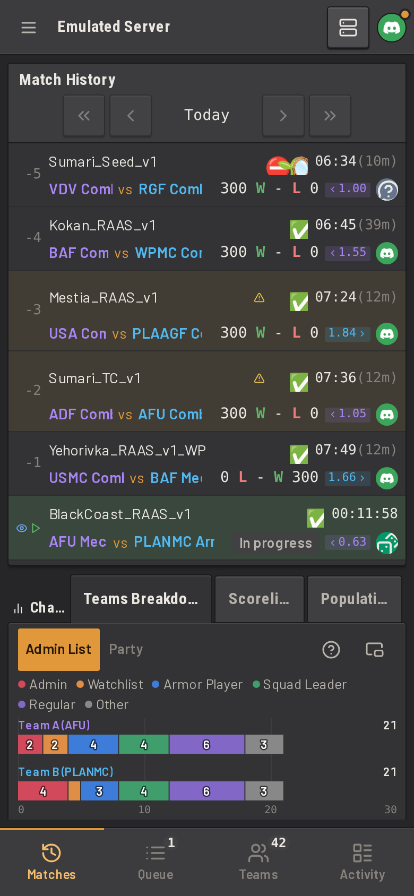

## Charts

The _Charts_ panel displays charts of the live match, or of a match opened from the match history. Each chart can also
open in a window of its own.

### Teams breakdown

The _Teams Breakdown_ chart counts each team's players by group of the chosen grouping mode. A grouping mode sorts
players into groups, such as by admin list group or BattleMetrics flag (see
[Teams and balance](player_management.md#teams-and-balance)). A segment of the chart filters the teams panel to its
group.

### Scoreline

The _Scoreline_ chart lists each team's tickets, kills, deaths and wounds, and plots kills, deaths, the kill lead or
tickets across the match. Tickets update live while the match is in progress. The kill lead is how far one team's kills
are ahead of the other's, shaded in the leading team's colour.

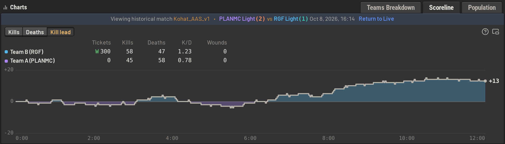

### Spoilers

The current match's scoreline, its tickets, each player's role and vehicle, and each player's and squad's kills, wounds
and deaths are hidden by default, since they can give an in-game advantage. Turn on _Show Spoilers_ in the teams panel
to show them. Spoilers show by themselves once a match ends.

### Population

The _Population_ chart plots how many players were on the server, over one match or over the last 6 hours, 24 hours or
7 days. The chart splits the players into active and idle players (see
[Idle players](../guide/configuring/players.md#idle-players)), or draws a line per team. Lines mark where each match
started and where its round ended, and a match picked on the chart opens in the panel and the activity feed.

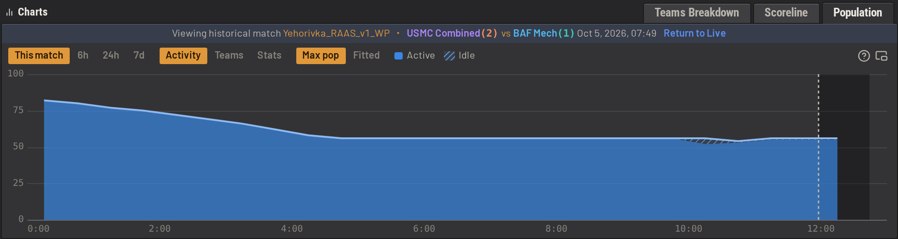

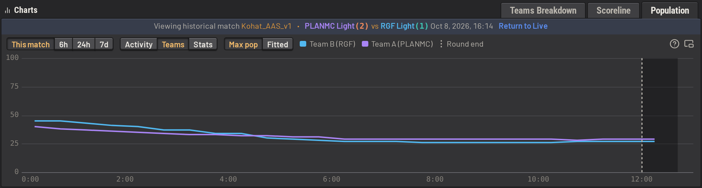

_Stats_ summarizes the same time span, such as the peak player count, how long the server was full and how quickly
players come and go.

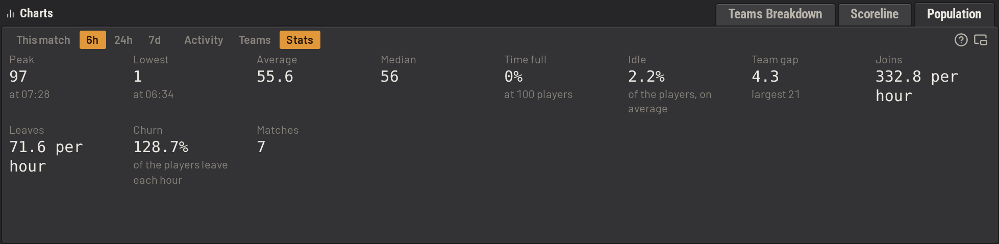

## The history page

Use the history page to search past events, players and matches by player, time, event type, layer, outcome and more.
A query can be saved privately or shared with other admins, and results export as text or CSV.

A player can be searched by a Steam or EOS ID, or by part of any username they have gone by, including previous ones.

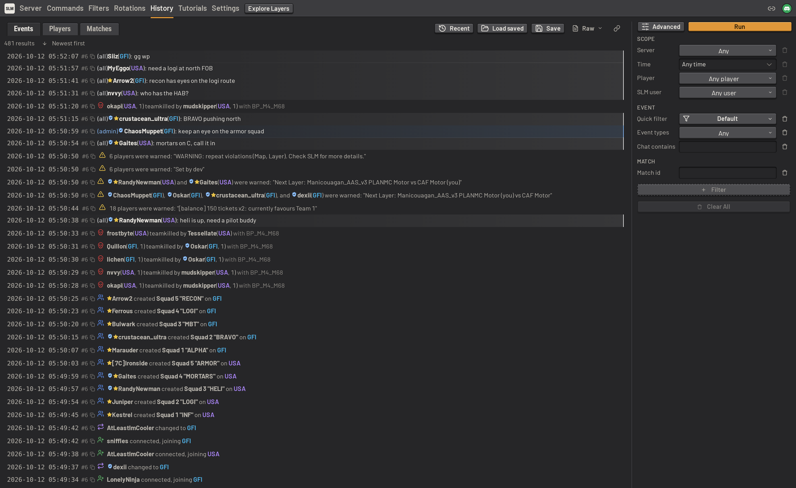

Times can be shown in any time zone, and a saved query or a shared link keeps its time zone.

### Players and matches

The _Players_ and _Matches_ tabs group the events a query finds by player or by match. A query can find regulars by
their match count, every player who was warned in the last week, or every one-sided match on a map.

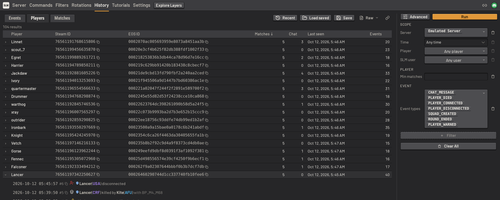

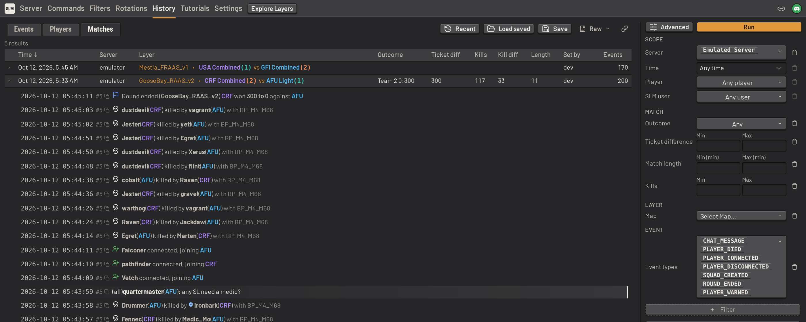

When a link to a selection of events is posted in Discord, SLM replies with the events attached as a text file. See
[Discord](integrations_and_hosting.md#discord).
