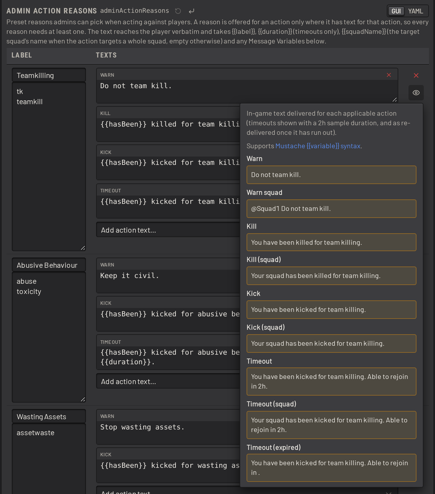
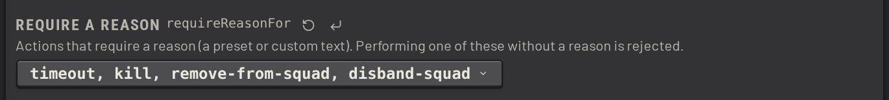
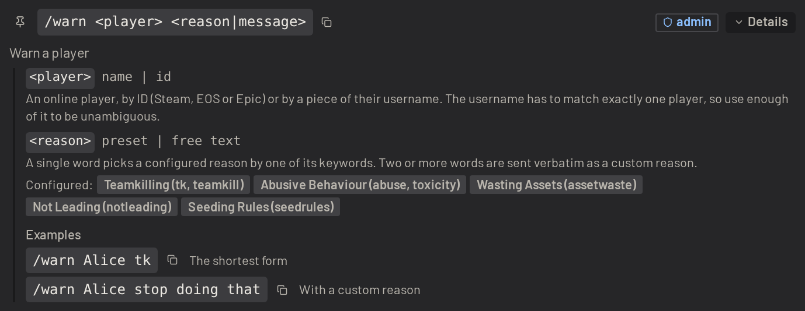
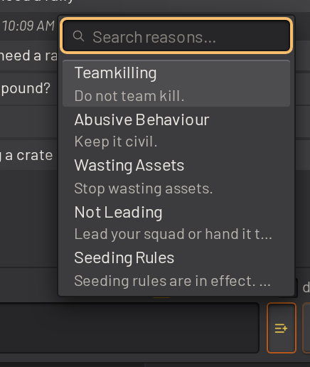
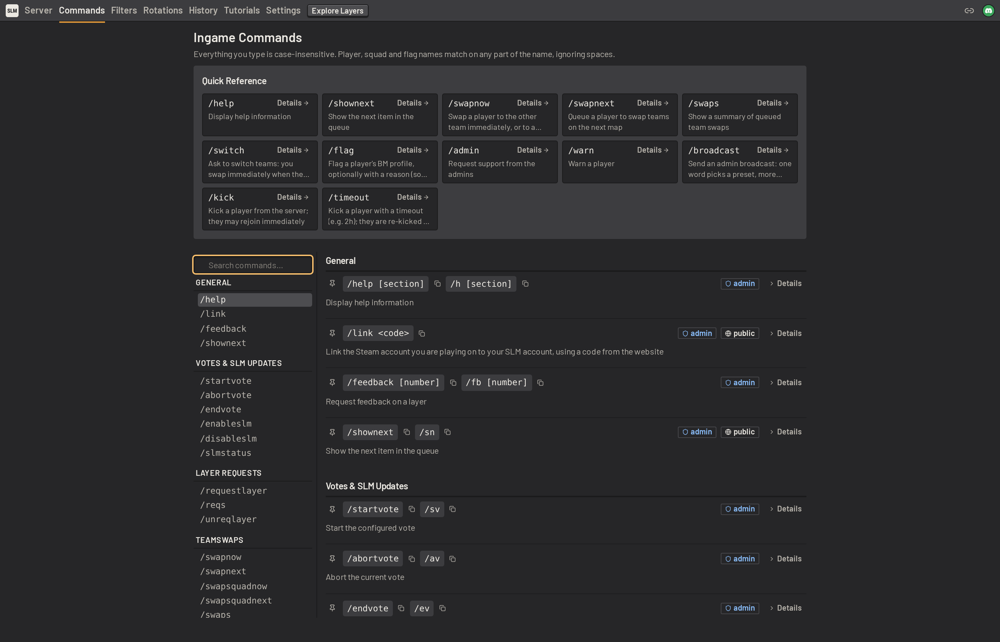
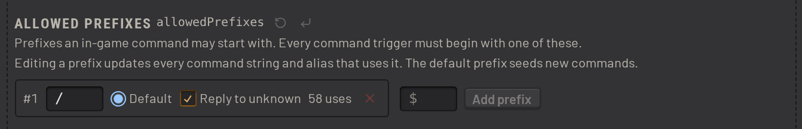

# Admin actions and commands

These settings control the messages SLM sends to players, and how admins reach SLM's commands in game.

## Warns, broadcasts and admin actions

The _Warns & Broadcasts_ section holds the messages SLM shows to players: admin warnings, kicks, broadcasts, and
more.

A message shorthand is a preset message for a common offence, such as teamkilling, spamming or soloing. Configure
shorthands under _Message Shorthands_. Each shorthand carries one text per action, where an action is a warn, a
broadcast, a kick, a timeout, and so on:



Write the texts as [mustache](https://mustache.github.io/mustache.5.html) templates. _Message Variables_ in the same
section holds reusable snippets. A message variable can be used in several texts, or inside another message variable.

When an action targets a whole squad, `{{squadName}}` holds the squad's name. For a single player it is empty, so
a section can switch the wording:

```
{{#squadName}}Your squad has been warned for{{/squadName}}{{^squadName}}You have been warned for{{/squadName}}
teamkilling.
```

Put the section inside a message variable to reuse it across shorthands.

_Require a Reason_ makes a reason mandatory for the actions listed in it:



A shorthand satisfies the requirement, and so does a freeform reason typed instead.

Admins use a shorthand's keyword as the reason in the in-game `/warn`, `/broadcast`, `/kick`, `/timeout` and other
commands, as long as that shorthand has text for the action: a shorthand with no kick text cannot be used to kick.



Shorthands can also be selected when an action is performed from the interface:




## In-game commands

The commands page in your own install documents each in-game command and how to use it:



### Command prefixes

By default, every command has the prefix `/`. Change this prefix, or add another, in _Allowed Prefixes_, under
_Advanced_ in the _In-game Commands_ section:



If an existing prefix is changed, SLM moves every [trigger](#command-triggers) with that prefix to the new one.

> [!TIP]
> Pick a prefix that does not collide with existing commands. Some SLM commands behave differently from their SquadJS
> counterparts, which confuses users. Disable the old command instead, with a message that points users at the SLM
> one.

### Command triggers

A command runs from one of its _triggers_, such as `/timeout` or `/to`. A trigger can also fill in some of the
command's arguments, as a shortcut. See [Command triggers](command_triggers.md).
