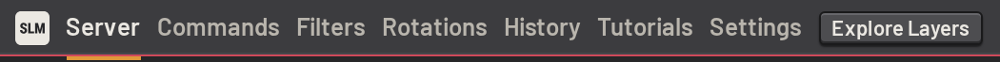
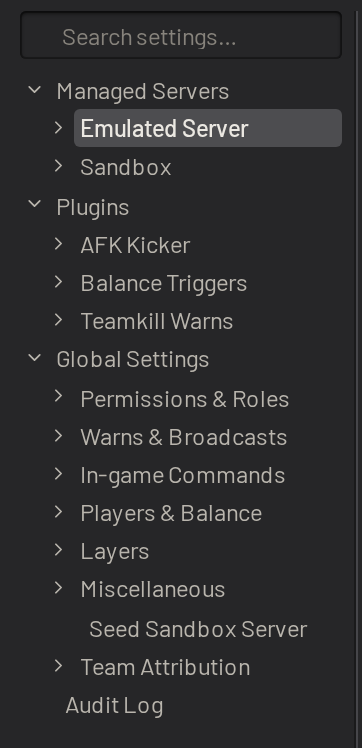
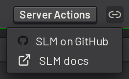

# Configuring SLM

This guide assumes a running instance of SLM. See [installing.md](../../installing.md) to set one up.

SLM is configured from the settings page, apart from the secrets and startup options set in `.env` (see
[installing.md](../../installing.md)). A few settings must be set before SLM can run your server. The rest can keep
their defaults.

Open the settings page from the header:

Use the table of contents on the left to move between sections:

Any setting can also be edited as YAML. Settings that few installs change are kept under _Advanced_ at the bottom of
their section. Any setting or section can carry a comment, to record why it is set the way it is.

## First steps

Set these up first, in this order:

1. [Permissions and users](permissions.md), so the right people can sign in and act.
2. [Servers](servers.md), to connect SLM to your Squad server.
3. [Layer pool and filters](layer_pool.md), to decide which layers your server plays.

The other pages in this section cover the remaining settings by topic.

## Nav links

The _Links_ menu in the nav bar holds links for your users, such as your community's rules or a Discord invite. A
fresh install starts with links to SLM on GitHub and to these docs.

- Links for every server are under _Miscellaneous > Nav Links_ in the settings.
- A server can add its own in its server settings. They show below the global ones while that server is selected.

Each link is a label and a url.
