# Players

These settings control how SLM sorts players into groups, when it counts a player as idle, how admins flag players
in BattleMetrics, and who SLM picks to counterbalance team swaps.

## Player grouping modes

A _grouping mode_ sorts players into named, coloured groups, for administration and for monitoring balance.
Configure them under _Players & Balance_.

A grouping mode is an ordered list of rules, and a player joins the group of the first rule they match.

A rule can match on:

- a BattleMetrics player flag
- an [admin list group](permissions.md#admin-lists)
- a regex on the player's username, which includes any tags they have configured
- a Discord role, if the player's Steam account is linked to their Discord account

A grouping mode keyed on admin list groups:

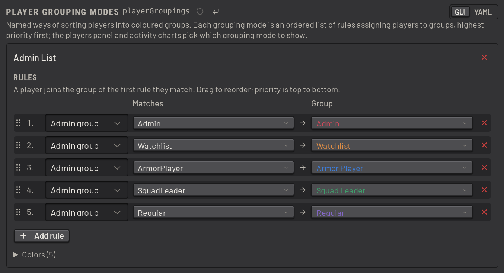

TacTrig's grouping mode for monitoring balance:

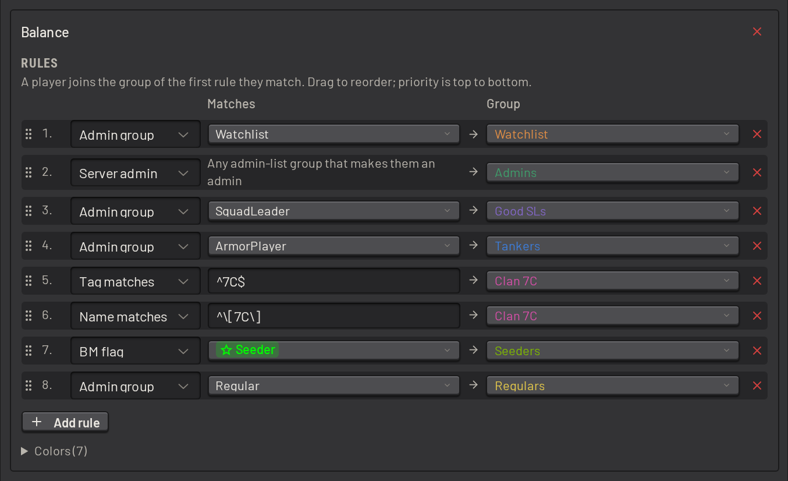

> [!NOTE]
> Discord and Steam accounts are linked by hand, from _Linked Steam Accounts_ in the user menu. See
> [Assigning roles](permissions.md#assigning-roles).

SLM then colour-codes the usernames of grouped players wherever they appear:

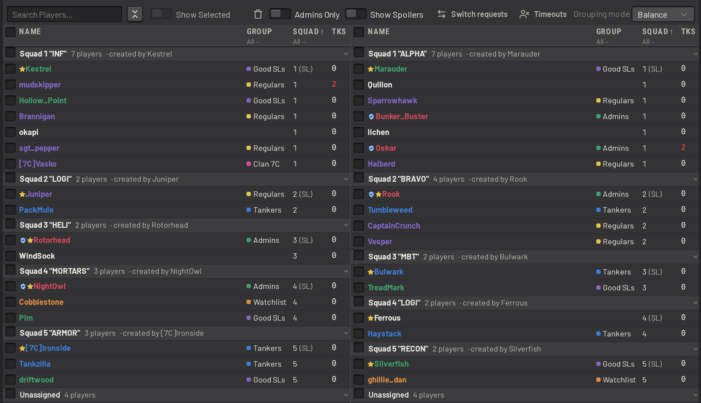

Choose which grouping mode to show in the players panel and the _Charts_ panel. The _Teams Breakdown_ chart breaks the population
down by the chosen mode:

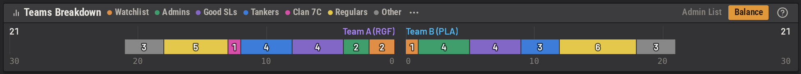

## Idle players

SLM counts a player as idle when they are outside a squad, on foot, and have gone a set time without a kill, wound,
death, chat message, or squad, team, role or vehicle change. A player who just connected counts as active. The
_Population_ chart and plugins such as the AFK Kicker read this rule.

Set the time under _Players & Balance_, in _Player Activity_. The time is one of 5, 10, 15, 20 or 30 minutes, and 10
by default.

## Player flagging

Flagging needs the BattleMetrics integration (see [BattleMetrics](integrations.md#battlemetrics)).

A BattleMetrics flag can be applied to a player from in game with the `/flag` command, or from the SLM interface:

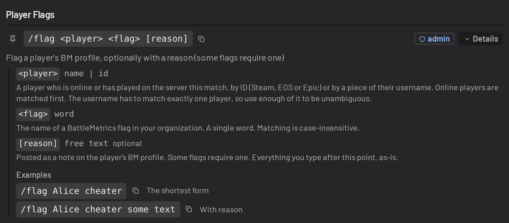
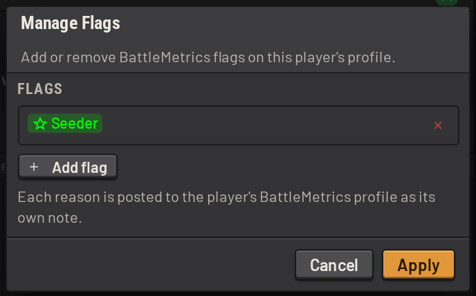

A user can add a reason for the flag, which SLM posts as a note on the player's BattleMetrics profile. The note is
freeform text, and is not connected to the [message shorthands](admin_actions.md#warns-broadcasts-and-admin-actions).

To require a note for a particular flag, name it in _Player Flags Requiring Note_:

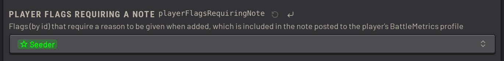
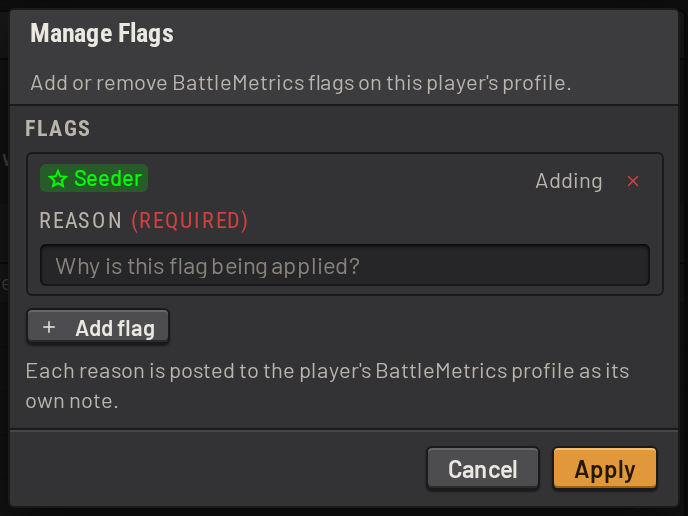

A flag set from the BattleMetrics interface can take a while to appear in SLM, which caches BattleMetrics data to stay
inside BattleMetrics' rate limits. To see a change immediately, purge the cache for that player with the
_refresh_ button:

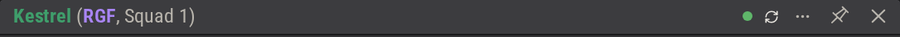

SLM refreshes a player's flags automatically when it changes them itself.

### Player notes

A note is free text on a player's BattleMetrics profile. SLM signs each note it posts with the name of the user who
wrote it. Adding a note needs the `battlemetrics:write-notes` permission.

To add a note:

- in game, use the `/note <player> <text>` command
- in the player details window, click the notebook button beside the flags
- right-click a player, a squad or a selection, and pick _Add Note..._

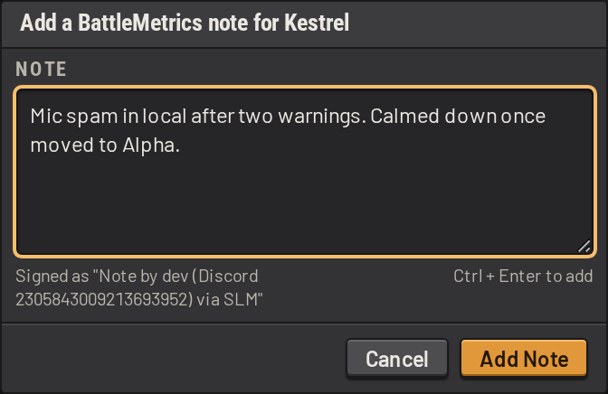

To read a player's notes, click _Load notes_ in the player details window. SLM fetches a player's notes only when
asked, since each fetch counts against your organization's BattleMetrics rate limit. SLM shows a note only when it is shared with
your organization, has no clearance level and has not expired.

### Personal BattleMetrics tokens

By default, SLM changes flags and posts notes with the organization's BattleMetrics token, and names the admin who made
the change. An admin can save a personal access token instead, so that their changes are made as their own
BattleMetrics account:

1. Open _BattleMetrics Token_ from the user menu.
2. Create a token on BattleMetrics with the scopes the dialog lists: adding and removing player flags, and creating
   player notes.
3. Paste the token and click _Save_.

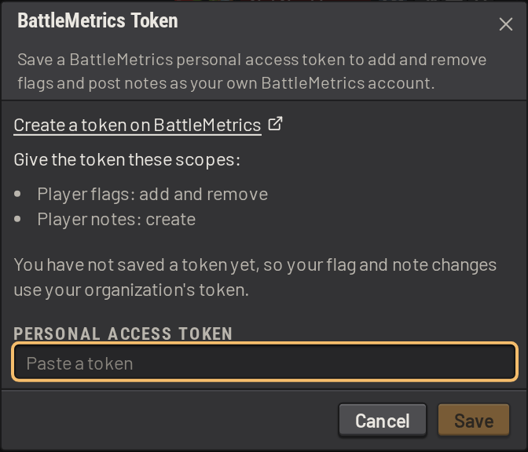

The token then applies to every change made from the web interface. In-game `/flag` and `/note` use it only when the
admin's Steam account is [linked](permissions.md#assigning-roles) to their Discord account.

## Teamswap counterbalance

Turn on _Counterbalance_, a switch in the swaps panel, to keep the teams even while admins edit the swaps. Whenever an admin
queues or removes a swap, SLM re-picks swaps from the other team so that the teams end up as even as possible:

- A party is always swapped together.
- SLM keeps the players it already picked for as long as the teams need them, even if they no longer match the
  settings below.
- Swaps queued with an in-game command are not counterbalanced.
- When an admin removes a counterbalance swap, SLM picks a different player.

If players joining, leaving or switching teams leave the saved swaps more than one player from even, a countdown
appears under the _Counterbalance_ switch. When it ends, SLM re-picks the counterbalance swaps and records the re-pick in
the activity feed. The countdown stops if the teams even out first. Use _Re-pick now_ to skip the wait, or _Skip_ to keep
the current swaps until the roster or the swaps change again. Unsaved edits are never changed.

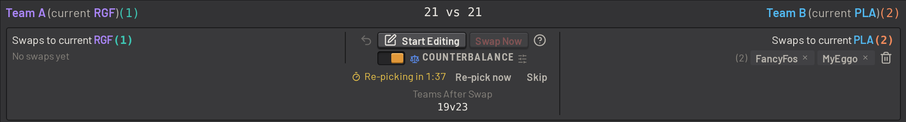

The _Teamswap Counterbalance_ server settings choose who SLM picks:

- _Never Picked Groups_: players in these groups, from your [player grouping modes](#player-grouping-modes), are never
  picked.
- _Never Picked Above_: a player with more kills or wounds, or a higher K/D, than the limit in the current match is
  never picked.
- _Picked First_: SLM ranks the remaining players by these lines, from top to bottom. A lower line only breaks ties
  left by the lines above it. A line can prefer a group, or the lowest or highest K/D, kills or wounds.
- _Roster Change Delay_: the length of the re-pick countdown, 2 minutes by default.

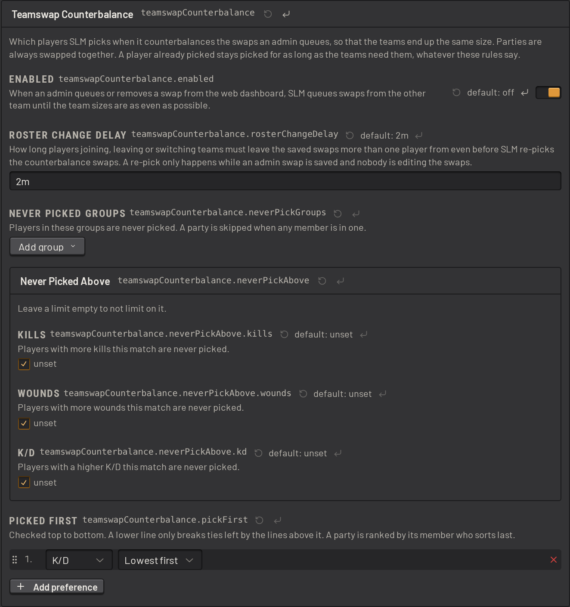

A party is skipped when any member may not be picked, and is ranked by the member who ranks lowest. A party that would
make the teams uneven again is passed over for a smaller one.
