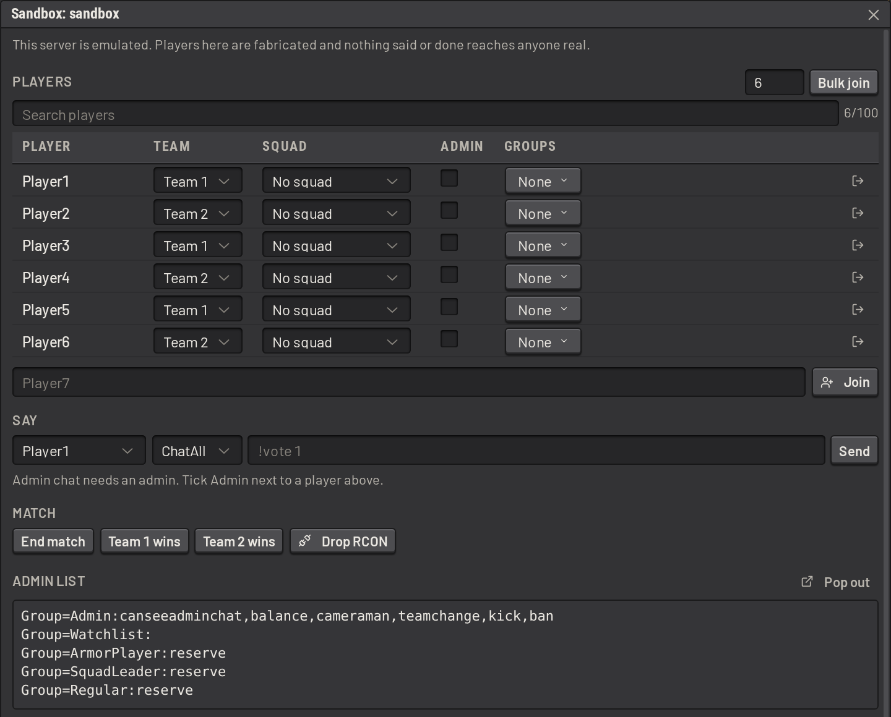

# Sandbox servers

A sandbox server is a Squad server SLM runs itself. There is no game server behind it: SLM starts an emulated Squad
server on the same machine, and connects to it over RCON as it would to a real one.

Use it to learn the queue, try a filter, rehearse a vote or reproduce a bug without affecting real players. SLM
creates one when a fresh install starts, so it opens to a working dashboard instead of a form asking for RCON
credentials.

## Using one

Set a server's connection type to `sandbox`, or let startup seed one (see below). Drive it from **Server Actions ->
Sandbox Controls**, which appears only on sandbox servers, and only for users holding `sandbox:control` on that server.
From there, connect fabricated players, speak as them in all or admin chat, form squads and parties, end matches, and drop the RCON
connection to watch SLM reconnect.

Check the roster, chat and queue on the dashboard. Open the [server console](server_console.md) from **Server
Actions -> Server Console** to watch the server's raw traffic.

## Seeding

_Seed Sandbox Server_, a global setting that is on by default, creates a server called `sandbox` at startup when none
exists. It is enabled immediately. It becomes the default server only when there is no other one, so an install already
running real servers gets the sandbox alongside them, never in front of them.

If the sandbox is deleted while the setting is on, the next restart creates a new one. Turn the setting off to remove it
for good.

## What is real and what is not

SLM treats a sandbox exactly as a live server, except in three ways:

- **BattleMetrics is off for sandbox servers**, so no flag or note written on a fabricated player reaches your
  organization.
- **The sandbox has its own admin list.** The list is kept in memory and edited from _Sandbox Controls_, where
  fabricated players can be made admins or put in groups. The default `admins` role is assigned to the admins of this
  list, so sandbox admins can run in-game commands.
- **The world is in memory.** Restarting SLM starts a fresh world, while the match history remains.

## Sandbox history is kept with the real history

SLM records a sandbox's events and matches exactly as for any other server. A history search that does not filter by
server includes them.

## Permissions

`sandbox:control` is server-scoped, so it is granted per sandbox and grants nothing on a real server. As with every
server-scoped permission, holding it implies `squad-server:view` for that server.

Sandbox Controls can only act on an emulator SLM started, so nobody can use them to drive a real server.
