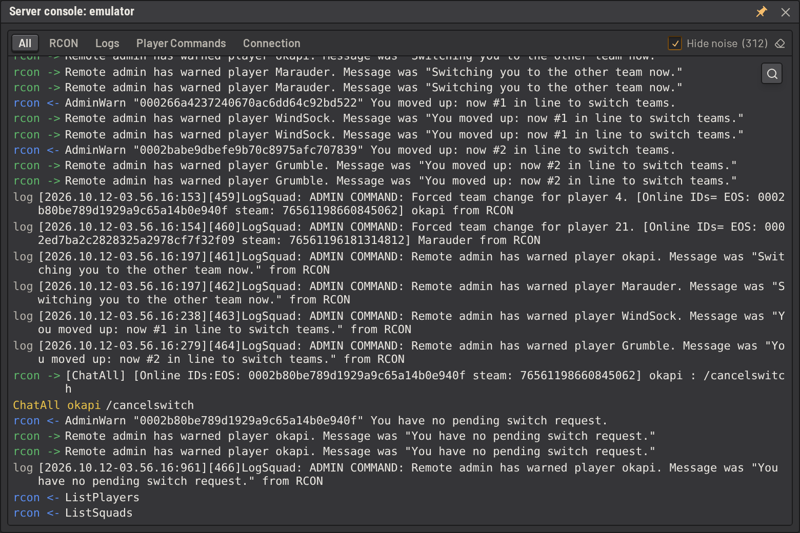

# Server console

The console streams a Squad server's raw traffic as it arrives: the RCON commands SLM sends and the server's responses,
the server's log lines, every chat message players send, and the state of SLM's connections to the server. The
console can also be used to run RCON commands on the server. It is available on every server, including sandboxes. The dashboard shows the state SLM derives from that traffic, and the
console shows the traffic itself. Use the console when the dashboard does not match what is happening on the server.

Open it from **Server Actions -> Server Console**. It is a draggable window, so it can stay open beside the dashboard
while a problem is reproduced.

## Channels

The console has four channels, one per tab.

- **RCON**: RCON commands and responses, in both directions. `rcon <-` is a command arriving at the game server,
  `rcon ->` is the server answering. The direction is always written from the server's point of view, even though
  SLM is at the other end, so a sandbox and a real server read the same way. A command run from the console is
  labelled with the name of the user who ran it instead of `rcon`.
- **Logs**: the raw log lines as ingested, before parsing. Lines from every source (local file, SFTP poll, server
  agent, sandbox) appear here as SLM received them.
- **Player Commands**: every chat message, with its chat channel and author. The channel records all chat, not only
  commands.
- **Connection**: SLM's connection attempts to the server, and any refusals, retries and disconnects, with the error
  behind each failure. It is the only channel that records anything while the server is unreachable.

## RCON filters

The RCON tab shows the commands run from the console and their responses. Two checkboxes add the rest of the RCON
traffic:

- **Show SLM requests**: the commands SLM sends to the server on its own, and the server's responses to them.
- **Show events**: the messages the server sends without being asked, such as chat.

## Hide noise

Hide noise is on by default. On a quiet server, nearly all traffic is SLM asking the same few questions on a timer and
getting the same answers, plus a tick rate line every couple of seconds. With the box ticked the console hides:

- an rcon exchange whose response is identical to the last response to that same command, request included
- the `Server Tick Rate` heartbeat

The count beside the checkbox shows how many entries are hidden. The checkbox appears on the Logs tab, and on the RCON
tab while **Show SLM requests** is ticked. A command run from the console is never hidden.

## Line wrapping

Long lines wrap by default. Use the wrap button beside the search button to turn wrapping off, so long lines
scroll sideways instead.

## Running commands

Type an RCON command into the box at the bottom of the RCON tab and press Enter. The command and the server's response
appear in the console, labelled with your name. If the server does not respond, the error appears below the box.
Press Up and Down in the box to step through earlier commands. The browser keeps the last 100 commands run from any
server's console, so the history survives closing the console and reloading the page.

Every command run from the console is recorded in the audit log and in the server's activity feed.

## Permissions

Two permissions control the console on a server:

| Permission                   | Grants                                        |
| ---------------------------- | --------------------------------------------- |
| `squad-server:view-console`  | Reading the console                           |
| `squad-server:write-console` | Reading the console and running RCON commands |

Both are separate from `squad-server:view` because the console discloses much more than the dashboard does: raw log
lines carry player IPs, Steam and EOS ids, admin chat and every admin action. Grant them to people who debug the
server, not to everyone who can look at it.

`squad-server:write-console` grants everything the server's RCON can do, including bans, layer changes and server
restarts. A command run from the console skips every other SLM permission, so grant it only to people who could be
trusted with the RCON password.

No role holds either permission until an admin grants it. Superusers have both, as they have everything.

## Retention

The console keeps a short backlog per server, in memory only. Opening the console shows that backlog and then the
live traffic. Restarting the server's connection clears the backlog.
