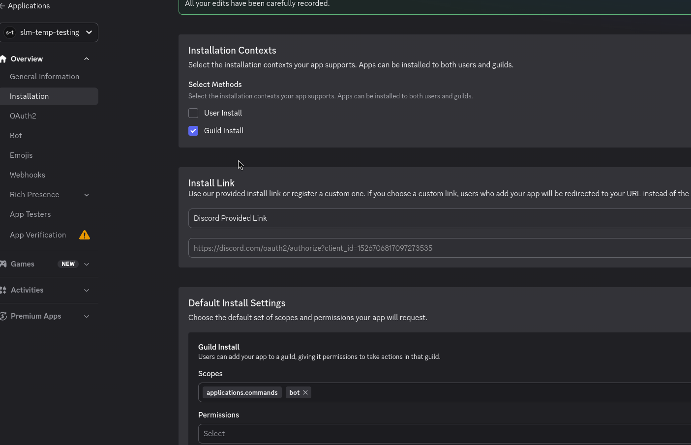
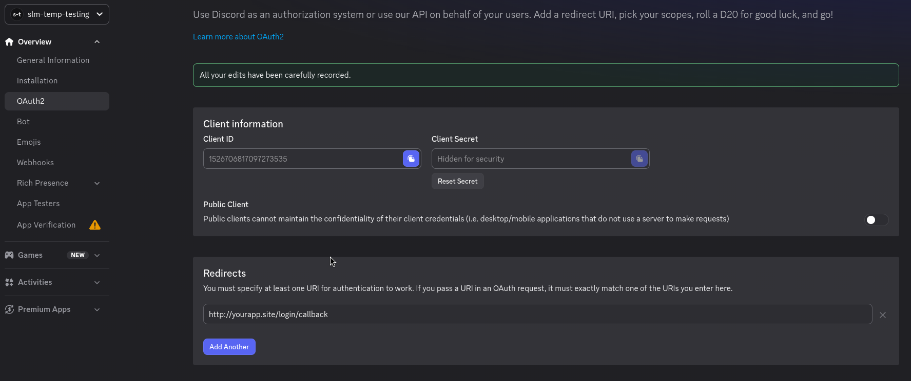
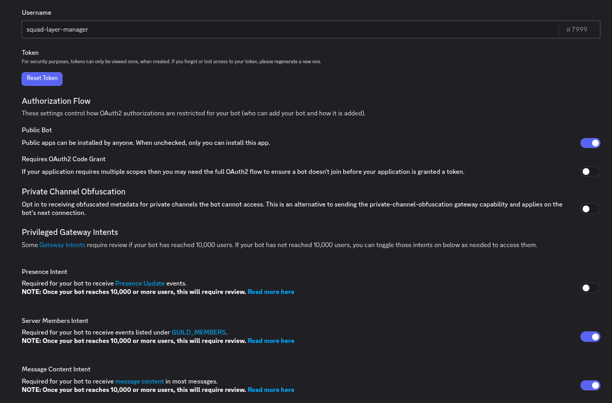

# Installing SLM

To try SLM before installing it, run the demo. See
[Trying SLM without installing it](features/learning_slm.md#trying-slm-without-installing-it).

## 1. Prerequisites

1. Docker, on the machine that will run SLM: [installation instructions](https://docs.docker.com/get-docker/)
2. A Discord server on which your account can install apps.
3. A domain, and a way to serve SLM over HTTPS, such as [Caddy](https://caddyserver.com/) or
   [Cloudflare Tunnel](https://developers.cloudflare.com/tunnel/). Caddy renews its certificates by itself. Cloudflare
   Tunnel needs no open port on your machine.

## 2. Where to install

SLM reads your Squad server's log file and connects to its RCON port. Choose where SLM runs by how it will reach them:

- **Recommended:** anywhere, with the [server agent](guide/operations/server_agent.md) running on the game host. The
  agent streams the log and proxies RCON over an encrypted connection, so the game host opens no extra port.
- On a machine that can mount the log file and reach RCON over a private network. This gives the lowest latency.
- Anywhere, reading the log over SFTP and RCON over the internet. RCON is not encrypted, so avoid this where possible.

[Connecting the server](guide/configuring/servers.md#connecting-the-server) describes each mode.

## 3. Download the deployment files

```sh
mkdir squad-layer-manager && cd squad-layer-manager
curl -fsSL https://raw.githubusercontent.com/Tactrigsds/squad-layer-manager/main/install.sh | bash
```

This installs the newest release. To install something else, pass a flag after `bash -s --`, such as
`bash -s -- --channel latest`:

| flag               | installs                                                                    |
| ------------------ | --------------------------------------------------------------------------- |
| `--channel stable` | the newest release, and each later release on upgrade. This is the default. |
| `--channel latest` | every change as soon as it passes tests                                     |
| `--version <v>`    | one release, e.g. `--version 2026.9.4`, and stays on it                     |

To install into another directory, add it last: `bash -s -- --channel latest /opt/slm`.

The script writes `docker-compose.yaml`, `.env`, `.env.secrets`, the `edit-global-settings.sh` and `restore.sh`
helpers, and an `observability/` directory. It creates `data/`, which holds the database.

## 4. Discord app

SLM signs users in through a Discord app of your own.

1. Create an app at [discord.com/developers/applications](https://discord.com/developers/applications).
2. Under _Installation_, keep only _Guild Install_ checked, and give it the `applications.commands` and `bot` scopes:

   

3. Under _OAuth2_, add `<ORIGIN>/login/callback` as a redirect, where `<ORIGIN>` is the address SLM will be served
   from:

   

4. Under _Bot_, turn on _Server Members Intent_ and _Message Content Intent_:

   

5. In `.env`, set `ORIGIN` to that address, without `/login/callback`, and `DISCORD_CLIENT_ID` to the app's client ID.
6. In `.env.secrets`, set `DISCORD_CLIENT_SECRET` and `DISCORD_BOT_TOKEN`.
7. In `.env`, set `DISCORD_HOME_GUILD_ID` to your Discord server's ID. Only its members can be granted access to SLM.
   To copy an ID, turn on Developer Mode in Discord's settings, then right-click the server icon or a user.
8. In `.env`, add your own Discord user ID to `SUPER_USERS`. A super user holds every permission. Without one, nobody can
   administer SLM.
9. Install the app on your Discord server with the install link from the _Installation_ page.

The install link must be public. SLM leaves any Discord server other than the one in `DISCORD_HOME_GUILD_ID`.

## 5. Secrets

`.env.secrets` holds the credentials SLM needs at startup. `install.sh` creates it with `chmod 600` and a generated
`SETTINGS_ENCRYPTION_KEY`, the key that encrypts your servers' passwords and tokens in the database. Keep
`.env.secrets` mounted into the container, as `docker-compose.yaml` does, and do not move its values into `.env`.

[Secrets and the encryption key](guide/operations/secrets.md) lists every secret, and describes secrets managers,
backing up the key and rotating it.

## 6. Backups

SLM backs up its database before every migration. To also back up on a schedule, set `AUTOMATIC_BACKUPS_PERIODIC` in
`.env`.

| variable                     | default          | what it does                                                          |
| ---------------------------- | ---------------- | --------------------------------------------------------------------- |
| `AUTOMATIC_BACKUPS_PERIODIC` | unset (disabled) | how often to back up, e.g. `72h`                                      |
| `BACKUPS_DIR`                | `./data/backups` | where backups are written                                             |
| `BACKUPS_RETAIN_COUNT`       | `10`             | how many backups to keep, locally and remotely. `0` keeps all of them |

[Backups and restoring](guide/operations/backups.md) describes uploading backups over SFTP and restoring one.

## 7. Configuring telemetry

`docker-compose.yaml` runs Grafana and the services that collect SLM's metrics, logs and traces. To run without them,
set `OTEL_ENABLED=false` in `.env`, and delete the `victoria-metrics`, `victoria-logs`, `victoria-traces`,
`otel-collector` and `grafana` services from `docker-compose.yaml`.

## 8. Starting SLM

```sh
docker compose up -d
```

SLM starts again after a reboot if Docker starts on boot. Open `ORIGIN` and sign in with Discord.

Stop everything with `docker compose down`, or only SLM with `docker compose stop app`.

## 9. Upgrading

1. Read the "For operators" notes of every release since yours in [CHANGELOG.md](../CHANGELOG.md). A "Breaking" note
   opens with the setups it affects, such as a plugin of your own or a short encryption key, and describes the change
   those setups need to upgrade. A setup the note does not name needs no change.
2. Run:

   ```sh
   docker compose pull && docker compose up -d
   ```

SLM backs up the database, then migrates it. [Upgrading and downgrading](guide/operations/upgrading.md) describes
release channels, running migrations by hand and upgrading an older install.

## 10. Downgrading

An older build cannot read a database that a newer build has migrated, and refuses to start on one. To go back,
restore the backup taken before the upgrade and pin the build it belongs to. See
[Rolling back a bad upgrade](guide/operations/backups.md#rolling-back-a-bad-upgrade).

Switching from `latest` to `stable` is a downgrade. See
[Switching from latest to stable](guide/operations/upgrading.md#switching-from-latest-to-stable).

## 11. Accessing telemetry

Grafana is served at `http://localhost:3001`, and accepts connections from the machine SLM runs on only, because its
logs and traces record every player and user. From another machine, forward the port:

```sh
ssh -L 3001:localhost:3001 <your server>
```

Then open `http://localhost:3001`, sign in as `admin` with the password `admin`, and set a new password. Three
dashboards for SLM are preconfigured. [observability/README.md](../observability/README.md) describes the stack and its
retention.

## 12. Complete

SLM is installed. Continue with [Configuring SLM](guide/configuring/overview.md).

To connect BattleMetrics, the Squad Browser or Steam, see [Integrations](guide/configuring/integrations.md).
BattleMetrics is _highly_ recommended.
